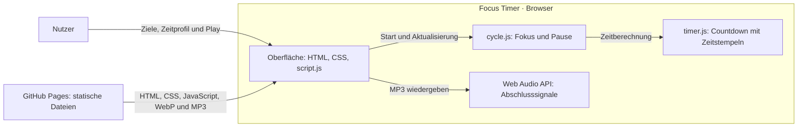

# Focus Timer — Fokuszeiten mit Zielen und automatischen Pausen

## Overview

Ein ruhiger Browser-Timer für konzentriertes Arbeiten: Ziele festhalten, Fokus- und Pausendauer wählen und starten. Während der Pause erscheinen die ursprünglichen Ziele wieder. Das Projekt verbindet eine bewusst reduzierte Oberfläche mit praktischer Arbeit an Browser-Technologien und testbarer Timer-Logik.

**[Timer öffnen](https://crnly.github.io/focus-timer/)**

## Features

- Ziele in bis zu vier sichtbaren Textzeilen eingeben und per Play starten.
- Fokus und Pause kombinieren: 15 + 5, 20 + 5, 25 + 5, 30 + 10, 35 + 10, 40 + 10 oder 50 + 10 Minuten.
- Während der Fokuszeit nur den Countdown sehen; die Pause startet automatisch.
- In der Pause die gesetzten Ziele wiedersehen; unterschiedliche Klänge markieren beide Phasenenden.
- Nach der Pause mit leerer Zieleingabe zurückkehren und die nächste Sitzung selbst starten.
- Ohne Konto arbeiten: Ziele bleiben nur im offenen Tab. Neuladen oder Schließen beendet die Sitzung.

<details>
<summary><strong>Tech Stack</strong></summary>

| Bereich | Technologie | Verwendung |
| --- | --- | --- |
| Oberfläche | HTML, CSS, JavaScript | Einseitige Browser-Anwendung ohne UI-Framework oder Build-Schritt |
| Timer und Audio | Browser-APIs, Web Audio API | Zeitstempelbasierter Countdown und Wiedergabe lokaler MP3-Dateien |
| Medien | WebP, MP3 | Hintergrundbild und zwei Abschlusssignale |
| Tests | Node.js 24, `node:test`, `node:assert`, `node:vm` | Logiktests und Oberflächenabläufe mit simuliertem DOM und Uhr |
| Prüfung und Hosting | GitHub Actions, GitHub Pages | Automatische Syntaxprüfung und Tests; statische Veröffentlichung aus `main` |
| Dokumentation | D2, Mermaid | Ablaufdiagramm und vereinfachter Architekturüberblick |

</details>

<details>
<summary><strong>Projektstruktur</strong></summary>

```text
focus-timer/
├── .github/
│   └── workflows/
│       └── checks.yml       # Automatische Syntaxprüfung und Tests
├── assets/
│   ├── break-end.mp3        # Zwei Holzschläge am Pausenende
│   ├── focus-end.mp3        # Abschlusssignal der Fokuszeit
│   └── pines.webp           # Hintergrundbild der Timer-Karte
├── docs/
│   ├── flow.d2              # D2-Ablauf: Theme 101, Sketch-Modus
│   └── flow.svg             # Gerendertes Ablaufdiagramm
├── tests/
│   ├── app.test.cjs         # UI-Abläufe, Eingabe und Audio mit Test-DOM
│   ├── cycle.test.cjs       # Zeitprofile und Phasenwechsel
│   └── timer.test.cjs       # Countdown und verzögerte Zeitabfragen
├── .gitignore              # Lokale Dateien ausschließen
├── .nojekyll               # Statische Auslieferung ohne Jekyll
├── README.md               # Projektübersicht
├── cycle.js                # Fokus-Pausen-Zyklus und Zeitprofile
├── index.html              # Oberfläche und Einstiegspunkt
├── script.js               # Eingabe, Darstellung, Audio und Ereignisse
├── style.css               # Layout und Darstellung
└── timer.js                # Countdown unabhängig von der Oberfläche
```

</details>

## Getting Started

Voraussetzungen: ein aktueller Browser und Python 3 für den lokalen Dateiserver. Es ist keine Installation von Projektabhängigkeiten nötig.

Im Projektordner ausführen:

```sh
python3 -m http.server 8000 --bind 127.0.0.1
```

Anschließend [localhost:8000](http://127.0.0.1:8000) öffnen. Mit Strg+C beenden. Der Server liefert nur Dateien aus; die Anwendung läuft im Browser.

**Prüfen:** Mit Node.js 24 `node --test tests/*.test.cjs` ausführen. **D2 neu rendern:** Mit installiertem D2 `d2 docs/flow.d2 docs/flow.svg` ausführen.

## Engineering & Quality

Die sieben Referenzen geben meiner persönlichen Weiterentwicklung eine Richtung. Ich möchte die dahinterstehenden Prinzipien an echten Projekten selbst anwenden, Erfahrungen sammeln und dadurch die Qualität meiner Arbeit Schritt für Schritt verbessern.

- **SOLID:** Verantwortlichkeiten klar trennen und Änderungen überschaubar halten. Erste Aufteilung: [Countdown](timer.js), [Phasensteuerung](cycle.js) und [Oberfläche](script.js).
- **Test Pyramid:** Logik und Zusammenspiel gezielt testen. Vorhanden sind [Timer-Tests](tests/timer.test.cjs), [Zyklustests](tests/cycle.test.cjs) und [UI-Abläufe mit simuliertem DOM](tests/app.test.cjs); automatisierte Tests in einem echten Browser fehlen bisher.
- **CI/CD:** Änderungen automatisch prüfen und nachvollziehbar veröffentlichen. Der [Workflow](.github/workflows/checks.yml) prüft Syntax und Tests bei Push und Pull Request. GitHub Pages veröffentlicht separat aus `main`; die Veröffentlichung ist nicht an einen erfolgreichen Testlauf gekoppelt.
- **OWASP LLM Top 10:** Risiken von LLM-Anwendungen verstehen. Aktuell nicht anwendbar, da das Projekt keine LLM-Funktionalität enthält.
- **NIST CSF 2.0:** Sicherheitsrisiken systematisch betrachten und passende Maßnahmen ableiten. Eine Bewertung steht noch aus.
- **ISO 27001:** Informationssicherheit nachvollziehbar organisieren und dokumentieren. Eine Bewertung steht noch aus; eine Zertifizierung wird nicht beansprucht.
- **C4 Model:** Systemgrenzen und Verantwortlichkeiten verständlich darstellen: [Vereinfachter Architecture Snapshot (Mermaid)](#architecture-diagram) und [D2-Sitzungsablauf](docs/flow.svg) mit [Quelldatei](docs/flow.d2).<br>↓ ↓ ↓ ↓ ↓ ↓ ↓ ↓ ↓ ↓

<a name="architecture-diagram"></a>



## License

Für das Projekt wurde noch keine Lizenz festgelegt. Das [Fokussignal](assets/focus-end.mp3) ist ein gekürzter Ausschnitt aus [dieser externen Aufnahme](https://www.youtube.com/watch?v=u7Djn-G6uSk); eine Lizenzangabe dazu ist im Repository nicht dokumentiert. Das [Pausensignal](assets/break-end.mp3) wurde für das Projekt synthetisch erzeugt.
